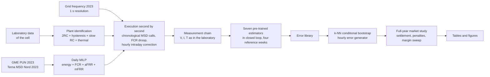

# soc2market

**Market value of state-of-charge estimation error for a battery providing reserves.**

[](https://www.python.org/)
[](LICENSE)
[](tests/)

This repository contains the simulation pipeline behind the paper

> L. Giannuzzo, D. S. Schiera, F. D. Minuto, and A. Lanzini, "Accuracy Is Not All That Matters: Cost
> of State-of-Charge Estimation Error for Revenue Stacking Batteries in Italy," submitted to the
> 2027 IEEE Power & Energy Society General Meeting (PESGM).

State-of-Charge (SOC) estimators are developed and ranked on laboratory accuracy metrics, although
the value they create is realized on electricity markets, where the estimate enters both the
scheduling and the real-time management of reserves. `soc2market` operates a 1 MW/2 MWh lithium
iron phosphate (LFP) battery on the 2023 Italian day-ahead and ancillary services markets in
closed loop with seven pre-trained SOC estimators, and measures in euros what their errors cost.

---

## Contents

- [Key findings](#key-findings)
- [How the pipeline works](#how-the-pipeline-works)
- [Repository layout](#repository-layout)
- [Installation](#installation)
- [Data](#data)
- [Reproducing the paper](#reproducing-the-paper)
- [Configuration](#configuration)
- [Tests](#tests)
- [Limitations](#limitations)
- [Citation](#citation)
- [License](#license)
- [Acknowledgment](#acknowledgment)
- [Contact](#contact)

---

## Key findings

Full year 2023, 52 weekly blocks with two replicates, losses paired against an oracle that knows
the true SOC (net revenue of the oracle: 209,120 €/MW/yr).

| Finding | Evidence |
|---|---|
| The laboratory ranking does not survive market operation | Root-Mean-Square Error (RMSE) of the learning-based estimators grows by up to four times; the Extended Kalman Filter (EKF) stays at 1.58 points |
| The market cost of estimation error is small | At most 1,870 €/MW/yr (< 1% of net revenue); only two of seven estimators differ significantly from zero |
| The RMSE does not predict the cost | Spearman correlation with the annual loss: 0.61 for the RMSE, 0.89 for the Mean Absolute Error (MAE), 0.82 for the overestimation between 10% and 20% SOC |
| The SOC margin matters more than the estimator | The optimal margin is set by the non-delivery penalty (0 to 1 point for k ≤ 5, 5 points for k = 10); once it is optimized, perfect SOC knowledge is worth less than 800 €/MW/yr |

## How the pipeline works



1. **Plant.** An equivalent-circuit model of the 280 Ah LFP cell (two fast RC branches, one-state
   dynamic hysteresis of the open-circuit voltage, a slow diffusion branch and a lumped thermal
   model), identified on hybrid pulse power characterization tests and validated on a multi-day
   dynamic profile (terminal-voltage RMSE 6.97 mV). The true SOC follows from the noise-free current.
2. **Market operation.** Every day a mixed-integer linear program plans energy arbitrage at the
   single national price (PUN) and five reserve products, with award and activation probabilities
   conditioned on season, day type and hour. The plan is then executed second by second: FCR
   follows the measured grid frequency, aFRR and mFRR are called in the hours in which the ex-ante
   MSD of the northern zone was actually active, and the operator corrects the base power every
   hour toward the planned SOC trajectory.
3. **Estimators in closed loop.** Seven estimators (EKF, five hybrids in which an ANN, CNN, LSTM,
   CatBoost or TFT model corrects the EKF, and an ensemble selector) read the simulated
   measurements on four reference weeks of 2023, without any retuning.
4. **Error generator.** The closed-loop errors are resampled hour by hour with a k-nearest-neighbor
   conditional bootstrap (Lall and Sharma, 1996), conditioned on the true SOC and on the error of
   the previous hour, so that state dependence, persistence and heavy tails are preserved.
5. **Market study.** The full year is simulated for an oracle and for every estimator, under several
   operating strategies (no margin, fixed 10% to 90% window, error-based margins) and a sweep of
   symmetric SOC margins, with settlement on the energy actually
   delivered (forfeited capacity, non-delivery penalty k × energy price, degradation cost).

## Repository layout

```
soc2market/
├── src/soc2market/
│   ├── plant/          cell model, parameter identification, pack scaling, sensors
│   ├── bidding/        daily MILP wrapper, rolling horizon, feasibility checks, schedule
│   ├── signals/        frequency archive, MSD archive, realisation of awards, power profiles
│   ├── estimation/     bridge to the frozen code of the pre-trained estimators
│   ├── errormodel/     error library loader, k-NN generator, replay check
│   ├── simulation/     market study: configurations, execution, settlement
│   ├── figures/        common figure style
│   └── paths.py        result folders, switched by the MSD realisation mode
├── scripts/            numbered steps of the pipeline (see below)
├── tests/              unit and regression tests (pytest)
├── external/           frozen third-party and legacy code (see external/README.md)
├── data/               input data, not tracked by git (see data/README.md)
└── results/            outputs of the scripts, not tracked by git
```

## Installation

Python 3.11 or later is required; use 3.11 or 3.12 if you need the frozen estimator code, whose
pinned stack (TensorFlow 2.18) does not support newer versions.

```bash
git clone https://github.com/<user>/soc2market.git
cd soc2market
python -m venv .venv
# Windows: .venv\Scripts\activate    Linux/macOS: source .venv/bin/activate
pip install -e ".[solver,dev]"
```

- The daily MILP is solved with **Gurobi** through PuLP, so a valid Gurobi license is required; a
  free academic license is available at [gurobi.com/academia](https://www.gurobi.com/academia/).
- The scripts that touch the laboratory data or the frozen estimator code (03 to 07, 10 to 12
  and 20) also need `pip install -e ".[estimators]"`, which pins the library versions with which the
  models were saved, and the private artifacts described in [data/README.md](data/README.md).
- **PyCharm:** open the folder, select the `.venv` interpreter, mark `src` as *Sources Root*, then
  run any script with right-click > *Run*. Tests run with the green arrow next to each test.

## Data

No data are redistributed in this repository. The public inputs can be downloaded by anyone, while
the laboratory data and the trained estimators belong to a third party and are not public.

| Input | Source | Where it goes |
|---|---|---|
| Day-ahead prices (PUN) 2023 | [GME](https://www.mercatoelettrico.org) | `data/market/` |
| MSD ex-ante outcomes, northern zone, 2023 | [Terna](https://www.terna.it) | `data/market/` |
| Grid frequency 2023, 1 s | [Zenodo 10.5281/zenodo.15784548](https://doi.org/10.5281/zenodo.15784548) | `data/frequency/` |
| Laboratory data of the cell, trained estimators | private | `data/private/`, `external/soc_estimators/` |

Exact file names, formats and conversion steps are in [data/README.md](data/README.md).

## Reproducing the paper

Scripts are numbered in execution order and read their settings from constants at the top of the
file. The market pipeline writes to `results/<MSD mode>/` (see [Configuration](#configuration)),
the plant scripts to `results/plant/` and the laboratory benchmark to `results/lab_benchmark/`.

| Step | Script | Produces | Paper | Needs private data |
|---|---|---|---|---|
| 1 | `03_identify_plant.py` | plant parameter tables | Sec. II-A | yes |
| 2 | `04_validate_plant.py` | voltage validation (6.97 mV) | Sec. II-A | yes |
| 3 | `09_convert_frequency.py` | `data/frequency/2023.npz` | Sec. II-C | no |
| 4 | `10_generate_duty_cycles.py` | four reference weeks, one file per day | Sec. II-C | yes |
| 5 | `11_run_estimators.py` | closed-loop SOC of the seven estimators | Sec. II-B | yes |
| 6 | `13_error_model.py` | error library, accuracy metrics | Table I | no (needs step 5) |
| 7 | `14_validate_error_generator.py` | generator validation | Sec. II-D | no (needs step 6) |
| 8 | `15_market_study.py` | full-year losses of all configurations | Table I, Fig. 3 | plant tables |
| 9 | `16_market_sensitivity.py` | penalty factors, rank correlations | Sec. III-B | no (needs step 8) |
| 10 | `17_margin_sweep.py` | margin sweep, value of perfect SOC | Table II, Fig. 2 | plant tables |
| 11 | `18_sweep_diagnostics.py` | revenue components per margin | Fig. 4, Sec. III-C | no (needs step 10) |
| 12 | `19_paper_figures.py` | Figs. 1 to 4 (PNG and PDF) | Figs. 1 to 4 | no (needs steps 6, 8, 10) |
| 13 | `20_lab_benchmark.py` | laboratory RMSE of the estimators | Table I | yes |

Steps 8 and 10 are the most expensive (a few hours each on a multi-core desktop) and run in
parallel over the weekly blocks. Scripts `00` to `02`, `05` to `07` and `12` are diagnostics that
document checks made during development (reuse of the MILP optimizer, time base of the
laboratory workbooks, sign convention of the EKF, outliers of two hybrids); they are not needed to
reproduce the results.

## Configuration

| Setting | Location | Default | Meaning |
|---|---|---|---|
| `MSD_MODE` | `src/soc2market/paths.py` | `"chronological"` | aFRR and mFRR calls follow the 2023 MSD history (`"bernoulli"`: independent draws) |
| `SCOPE`, `QUICK` | `scripts/15_market_study.py` | `"year"`, `False` | full year or four reference weeks; quick subset for testing |
| `ANALYSE_ONLY` | `scripts/17_margin_sweep.py` | `False` | re-analyze an existing sweep without simulating |
| `PENALTY_K` | `src/soc2market/simulation/market.py` | `1.5` | non-delivery penalty factor used by the MILP |
| `TECHNICAL_WINDOW` | `src/soc2market/simulation/market.py` | `(0.05, 0.95)` | SOC window before any margin |
| sustain durations | `external/marl_bess/market_constants.py` | 0.25 h, 1 h, 2 h | energy adequacy of FCR, aFRR, mFRR |

Results of different MSD modes are written to separate folders and never mix.

## Tests

```bash
pytest            # all tests
pytest -m "not slow"
```

Tests that need private artifacts, market workbooks or Gurobi are skipped automatically, and the
skip message lists the missing paths. The regression tests check that the frozen MILP and the
frozen estimators reproduce their reference outputs before any new result is produced.

## Limitations

The results rest on a single unit represented by one cell with laboratory-grade sensors, a plant of
the same model family as the EKF, errors resampled from four reference weeks, ex-ante MSD
activity as a proxy for reserve activation, benchmark capacity prices (FCR was not remunerated in
Italy in 2023), penalty factors applied ex post to a schedule planned with k = 1.5, and a daily
schedule without an end-of-day SOC target. See Section IV of the paper.

## Citation

If you use this code, please cite the paper (see also [CITATION.cff](CITATION.cff)):

```bibtex
@inproceedings{giannuzzo2027accuracy,
  author    = {Giannuzzo, Lorenzo and Schiera, Daniele Salvatore and Minuto, Francesco Demetrio and Lanzini, Andrea},
  title     = {Accuracy Is Not All That Matters: Cost of State-of-Charge Estimation Error for Revenue Stacking Batteries in Italy},
  booktitle = {2027 IEEE Power \& Energy Society General Meeting (PESGM)},
  year      = {2027},
  note      = {Submitted}
}
```

## License

The code is released under the [MIT License](LICENSE). The license does not cover third-party
data (GME, Terna, Zenodo), which remain subject to the terms of their providers, nor the private
artifacts referenced by the pipeline.

## Acknowledgment

This work was carried out within the project "Network 4 Energy Sustainable Transition – NEST",
Project code PE0000021, Concession Decree No. 1561 of 11.10.2022 adopted by Ministero
dell'Università e della Ricerca (MUR), CUP E13C22001890001, funded under the National Recovery and
Resilience Plan (NRRP), Mission 4 Component 2 Investment 1.3, by the European Union –
NextGenerationEU.

## Contact

Lorenzo Giannuzzo, Energy Center Lab, Politecnico di Torino, lorenzo.giannuzzo@polito.it.
Questions and bug reports are welcome as [GitHub issues](../../issues).
